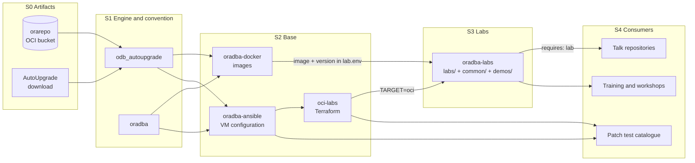

# Lab architecture

This document describes how oradba-labs fits into the wider OraDBA tooling: which repository owns which concern, how
a lab is started, reset and rebuilt, and which design decisions are fixed. The goal is simple: a lab for a session,
a demo or a training must run at the push of a button, and every lab exists exactly once.

## Start here - I need ... -> decision -> build

<!-- markdownlint-disable MD013 MD060 -->
| I need ... | Decision | Build it here | Command |
| --- | --- | --- | --- |
| a database for a demo, a talk or a training | pick a lab from `catalogue.md`; if none fits, add a new lab here (never in a talk repository) | `labs/<name>/` | `make up LAB=<name>` |
| a few scripts on top of an existing database | a demo, not a lab (`requires: <lab>`) | with the consumer; if reused, in `demos/` | demo `setup.sql` / `reset.sql` |
| a new or patched image (19c / 26ai EE and SE2, Free) | an image, no scenarios | `oradba-docker` (planned, M1); until then existing legacy images | image build via AutoUpgrade |
| to patch or upgrade a database | same data, new image (for example 19.32 -> 19.33) | `oradba-docker` plus the image version in `lab.env` | change the version in `lab.env`, then `make up` |
| a lab on OCI | decision E12: (a) container host, (b) DB VM | `oci-labs` (Terraform) plus `oradba-ansible` (VM) | `make up LAB=<name> TARGET=oci` (M5) |
| to configure a VM or OCI host | Ansible, never inside a container | `oradba-ansible` | collection `oradba.automation` |
| binaries or patches | an object storage bucket, not a repository | `orarepo` (OCI Object Storage bucket, accessed via PAR) or the AutoUpgrade download | - |
| to show how to customize Free | documented use case (E13) | `docs/` plus one lab | - |
<!-- markdownlint-restore -->

## Overview

Lab flow: choose the image (`lab.env`), then `make up LAB=<name>`. On an empty data directory the lab restores a
template (seed backup) if one is given, otherwise it creates the database with DBCA or uses the prebuilt Free
database, and then runs `setup/`. Every start runs `startup/`. Next comes the baseline (`LAB_BASELINE`), then the
demo scripts. `make reset` flashes back to the baseline, `make rebuild` starts from scratch, and `make down` stops
the lab (data is kept, `PURGE=1` deletes it).

## Layers and levels

Four layers (five with the consumer layer), one naming scheme `oradba-*`.

<!-- markdownlint-disable MD013 MD060 -->
| Layer | Question | Repository |
| --- | --- | --- |
| S0 Artifacts | Where do binaries and patches come from? | `orarepo` (OCI Object Storage bucket, accessed via PAR - not a git repository) or the AutoUpgrade download |
| S1 Engine and convention | How is an Oracle home built and patched? | `odb_autoupgrade`, `oradba` |
| S2 Images (container) | Which image? | `oradba-docker` (planned): `database/` (EE and SE2 via AutoUpgrade, Free with custom configuration), later `oud/` |
| S2 Infrastructure (OCI) | What does it run on in OCI? | `oci-labs` (Terraform building blocks) |
| S2 Configuration (VM) | How is a host configured? | `oradba-ansible` |
| S3 Labs and use cases | What is shown, practised or tested? | `oradba-labs`: scenarios plus `make up LAB=<name>` |
| S4 Consumers | Who uses it? | talk repositories, a patch test catalogue, training, workshops |

A demo does not have to be a standalone lab. There are three levels:

| Level | What | Where | Example |
| --- | --- | --- | --- |
| Base | image or container, or an OCI host, basic configuration | `oradba-docker`, `oci-labs` | a 19c image, a Free image |
| Lab | reusable environment on top of one or more bases, started with `make up LAB=` | `labs/` | `seclab`: default security lab with 19c and 26ai, Unified Auditing, lab users |
| Demo | one or two scripts (setup, run, reset) that run on a lab | with the consumer, or in `demos/` when reused | a privilege escalation module on `seclab` |
<!-- markdownlint-restore -->

Rules:

1. A lab exists once, in `oradba-labs`. Talks and trainings call it and never copy it. A demo names its lab
   (`requires: seclab`) and brings only its own scripts; when it is reused (talk and training), it moves to `demos/`.
2. Images know no scenarios. Scenarios know only image name, version and connection (one variable per lab, so
   switching to `oradba-docker` images is a one-line change).
3. Containers run without Ansible: image plus init and startup scripts; binaries and patches come through AutoUpgrade
   (download or `orarepo`). Ansible is for OCI and VM hosts only.
4. Shared SQL (sample schemas, tablespaces, PDB cloning, logging) lives only in `common/`.
5. Public repository: no binaries, no passwords (`.env.example` only), no customer or site data. Images stay private
   because of the Oracle license.

## Repository boundaries

All repositories are under [github.com/oehrlis](https://github.com/oehrlis).

<!-- markdownlint-disable MD013 MD060 -->
| Repository | Does | Does not | When |
| --- | --- | --- | --- |
| `oradba-docker` (planned) | images: software download and Oracle home via AutoUpgrade, init scripts per E8, template restore (E10), patching by switching the image on the same data, Free with custom configuration | no scenarios, no lab SQL | M1 / M2 |
| [`oradba-labs`](https://github.com/oehrlis/oradba-labs) | scenarios: `labs/<name>/` (compose, `setup/`, `startup/`, `lab.env.example`), `common/` (SQL and scripts, once), `make up/down/reset/rebuild/status/connect/verify LAB=`, demo convention | no image build, no Terraform, no Ansible | M0, migration in M3 |
| [`oci-labs`](https://github.com/oehrlis/oci-labs) | Terraform building blocks: network, hosts, targets; from M5 the target for `make up LAB= TARGET=oci` | no lab content, no Ansible roles (they move to `oradba-ansible`) | M4 / M5 |
| [`oradba-ansible`](https://github.com/oehrlis/oradba-ansible) | the only Ansible code: OS preparation, database install via AutoUpgrade on VMs and OCI, optionally a container runtime on the host | never inside containers | M4 (consolidation), M5 |
| [`odb_autoupgrade`](https://github.com/oehrlis/odb_autoupgrade) | home and patch engine, called by `oradba-docker` (containers) and `oradba-ansible` (VMs) | no lab knowledge | ongoing |
| [`oradba`](https://github.com/oehrlis/oradba) | environment and conventions in images and on hosts | - | ongoing |
| `orarepo` (OCI bucket, not a repository) | binaries and patches, accessed via PAR | - | ongoing |
| consumers (talk repositories, patch test catalogue, training) | demo scripts with `requires: <lab>`, own Terraform roots | no lab copies | ongoing |
<!-- markdownlint-restore -->

Related public repositories that are being absorbed: [`oracle-free-labs`](https://github.com/oehrlis/oracle-free-labs)
(Free image and configuration move to `oradba-docker`, use cases and profiles to `oradba-labs`) and
[`docker`](https://github.com/oehrlis/docker) (legacy, frozen; images move to `oradba-docker`, samples to
`oradba-labs`).

## Decisions

Earlier decisions in one line each:

- E1: image repository `oradba-docker`, following the `oradba-*` naming scheme.
- E2: lab repository `oradba-labs`, public, for all labs (not only security).
- E3: `oracle-free-labs` has outgrown its scope; image to `oradba-docker`, use cases to `oradba-labs`, then freeze.
- E4: existing legacy images are used until M2, then replaced by `oradba-docker` images.
- E5: containers use AutoUpgrade for binaries and downloads; Ansible only for VM and OCI.
- E6: a lab rule is added to the shared tooling and referenced from consumer repositories (M1).
- E7: whether `oci-labs` is renamed into the `oradba-*` scheme is open (M4).

<!-- markdownlint-disable MD013 MD060 -->
| ID | Decision |
| --- | --- |
| E8 | **Contract between lab and image = the Oracle container pattern** (`SingleInstance` in [github.com/oracle/docker-images](https://github.com/oracle/docker-images) and `container-registry.oracle.com`): `ORACLE_PWD`, `ORACLE_SID`, `ORACLE_PDB`, data in `/opt/oracle/oradata`, hooks in `/opt/oracle/scripts/setup` and `/opt/oracle/scripts/startup`, the image's own healthcheck. Labs run on Oracle standard images and on `oradba-docker` without changes; legacy images are mapped in the lab compose file until M2. |
| E9 | **Storage**: `LAB_DATA_BASE` in `lab.env`, `LAB_STORAGE=bind` (default, `<base>/<lab>/<db>`) for now; `volume` comes with Podman / cloud hosts (M5) - a `nocopy` volume is owned by root, without `nocopy` the prebuilt Free DB skips the setup hooks. The path carries no image version, so an image switch (19.32 -> 19.33) reuses the same data. Docker first, Podman later. |
| E10 | **Lifecycle**: empty data directory -> restore the template (RMAN backup or seed, if given), otherwise DBCA or the prebuilt Free database. `make reset` = flashback to `LAB_BASELINE` (seconds, for demos). `make rebuild` = data removed, rebuilt from template or creation. Seed restore is an image feature; images stay lean. |
| E11 | **seclab** = clean default environment (19c and 26ai, `DEMOPDB`, schemas, lab users). The deliberately insecure baseline from `oracle-free-labs` becomes an option later (`PROFILE=insecure`, M3). |
| E12 | **Lab on OCI**: (a) container host - `oci-labs` builds a VM with a container runtime and the same lab runs unchanged (`make up LAB= TARGET=oci`); (b) DB VM - `oci-labs` and `oradba-ansible` install natively via AutoUpgrade and the lab hooks run as SQL. (a) first, (b) second. Docker first, Podman second. |
| E13 | **Customizing Free as a documented use case**: adapting Free for an own use case (PDB, training, development environment) lives on as a documented example in `docs/` plus one lab; the image side belongs to `oradba-docker/database/free`. |
| E14 | **PDB naming**: one standard PDB with the core configuration (`LABPDB1`); same name = same content (cloneable), other content = other name (for example `DEMOPDB` in `seclab`). |
<!-- markdownlint-restore -->

## Roadmap

New labs are built only in `oradba-labs`, and from M2 only on `oradba-docker` images. Anything that does not fit is
recorded as a new decision instead of a parallel variant in another repository.

<!-- markdownlint-disable MD013 MD060 -->
| Milestone | When | Content | Exit |
| --- | --- | --- | --- |
| M0 | November 2026 | create `oradba-labs`; skeleton (`make list/up/down/reset/status LAB=`); labs `base19`, `base26`, `seclab` | `make up LAB=seclab` -> both databases healthy, connections printed; `make reset` in under 5 minutes |
| M0b | November 2026 | `oradba-labs` v0.2.0 with the E8-E11 mechanics; `base26` on the Free image with `LABPDB1`; `seclab` verifier tasks (19c), Unified Auditing with NOAUDIT, TDE | demo sessions start with `make up LAB=<lab>` plus a demo script |
| M1 | week 47 | create `oradba-docker` (Free with configuration, Dockerfile from the legacy repository); lab rule; clean up orphan repositories | rule deployed, no orphan repositories left |
| M2 | week 48 | `oradba-docker` builds 19c EE and Free via AutoUpgrade; labs switched to the new images; `oracle-free-labs` frozen | all labs run on `oradba-docker` images |
| M3 | week 49 | migrate use cases (audit, TDE, Database Vault, CMU, EUS, PDB, RMAN, patching); deduplicate SQL; archive `docker` | every sample is a lab in the catalogue or deliberately dropped |
| M4 | week 50 | consolidate Ansible; `oci-labs` without its own roles; decide E7 | `oci-labs` pins `oradba.automation` |
| M5 | week 51 | OCI runner: `make up LAB=<name> TARGET=oci` via the `oci-labs` building blocks; remaining OCI labs | one lab runs unchanged on Docker and on OCI |
<!-- markdownlint-restore -->
